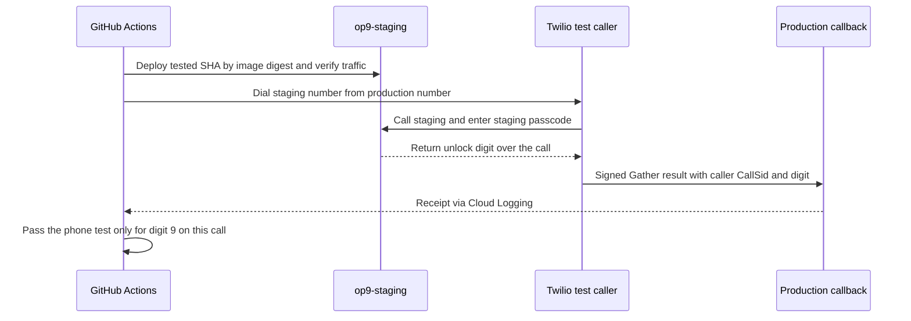

# op9 operations

Both Cloud Run services use project `operator9`, region `us-central1`.

**Staging.** From a feature branch, push as `dang3r`. Once the staging workflow is on `main`, successful offline CI triggers deployment and a live call for that push’s tip commit. Check `staging/phone-e2e` on that SHA.

```sh
git push -u origin HEAD
```

**Production.** After merge, deploy the committed source from `main` with the existing production settings. Run from the repository root.

```sh
(
  set -eu
  git fetch origin main
  src=$(mktemp -d)
  git archive --output="$src/main.tar" origin/main
  mkdir "$src/source"
  tar -xf "$src/main.tar" -C "$src/source"
  gcloud run deploy op9 --source "$src/source" --project operator9 --region us-central1
)
```

**Logs.** Look for the passcode decision in staging and the matching **caller** CallSid from the test report in production’s `phone-e2e` callback log.

```sh
gcloud run services logs read op9-staging --project operator9 --region us-central1 --limit 50
gcloud run services logs read op9 --project operator9 --region us-central1 --limit 50
```

**End-to-end test.** The workflow holds staging through the call so another branch cannot change the revision under test.



For a failed call, open the Actions run summary for the received digit and transcript, if available. For local offline checks, run `MODE=auto ANTHROPIC_API_KEY=offline uv run --locked pytest -m 'not phone_e2e' -q`. See [workflow setup](docs/github-actions.md) for credentials and the staging trust boundary.
