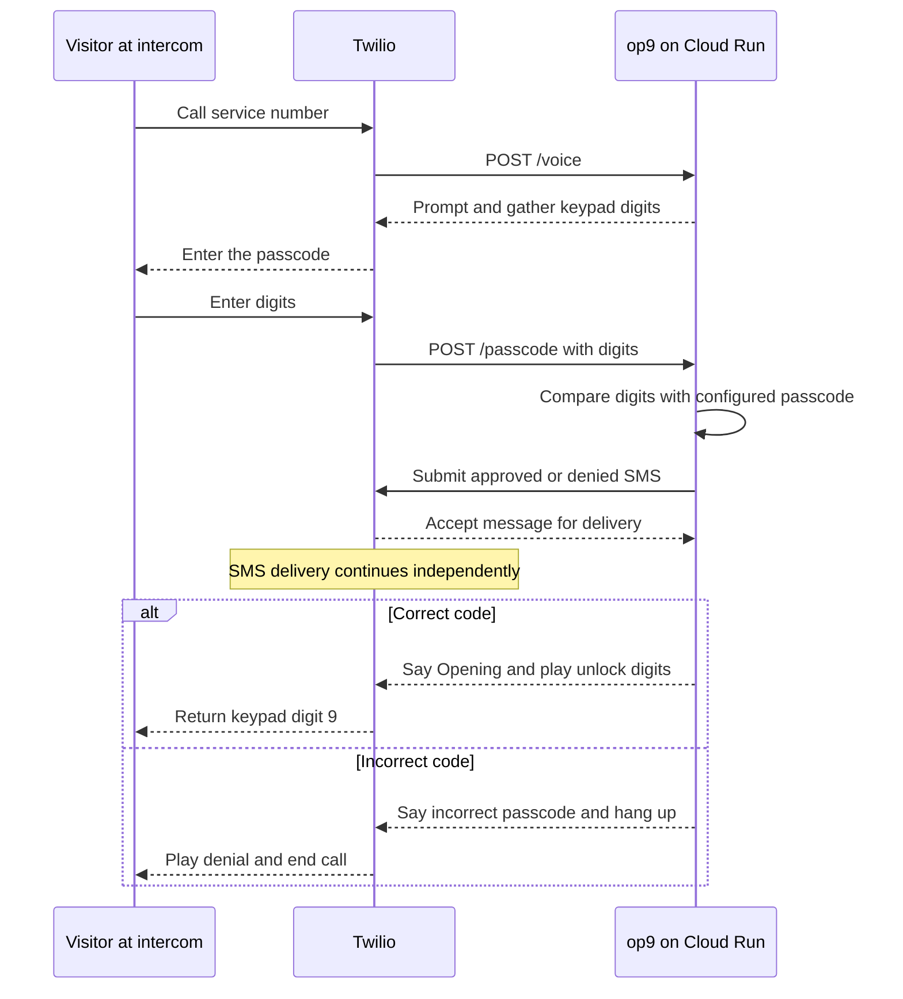
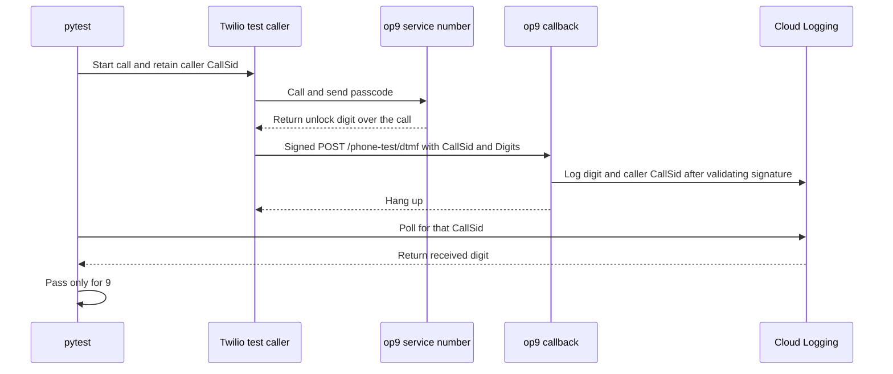

# op9

op9 answers an apartment intercom through Twilio. When a visitor enters the correct passcode, the service sends the keypad digit `9` back to the intercom to unlock the door.

## Visitor entry



op9 waits for SMS submission before returning the door instructions. Delivery to the handset can happen later. If submission fails, op9 still returns the passcode decision. If the visitor enters nothing, Twilio hangs up without calling `/passcode` or sending a summary.

## Live phone test

A separate Twilio number plays the visitor. After sending the passcode, it uses Twilio’s `Gather` to listen for one returned keypad digit.



The assertion verifies what the test caller received over the phone. The physical lock and SMS delivery are outside its scope. Set `E2E_CALLER_NUMBER` on the service to label that caller’s SMS summaries with `[TEST]`.

## Run and deploy

With Python 3.13 and uv, run the offline suite from the repository root:

```bash
MODE=auto uv run pytest -m 'not phone_e2e' -q
```

- [Deploy the passcode service](docs/deployment.md) covers Cloud Run configuration, Twilio webhooks, and notification logs.
- [Run the live phone test](docs/live-test.md) covers credentials, the opt-in command, and the saved test result.
- [Read the experiment notes](docs/experiments.md) for automatic entry, voice-agent screening, personal challenges, and SMS approvals.
